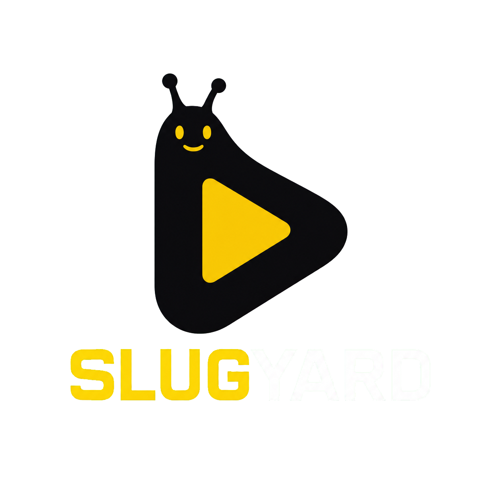

<div align="center">

  
  <br />
  <br />

  [![License][license-shield]][license-url]

  <p>
    A modern Android TV media player powered by the Stremio addon ecosystem.
    <br />
    Dual-engine playback (ExoPlayer + libmpv) · Debrid integration · Anime-optimized subtitles
  </p>

</div>

## About

SlugYard is an independently maintained Android TV media experience: connect a supported debrid account and press play. It is designed for remote-first browsing, local playback, optional profiles, and opt-in account sync.

The project is released under GPLv3. Required upstream attribution and third-party notices are maintained in [NOTICE](NOTICE) and [LICENSE](LICENSE).

## Release notes

### 0.1.0-beta — July 16, 2026

- Complete SlugYard rebrand across the Android TV app, launcher artwork, settings, and public project links.
- Catalog-first TV home experience with focused rows, profile switching, and Trakt-backed Continue Watching.
- Automatic stream scoring and next-episode selection, with Torbox, Premiumize, and Real-Debrid support.
- Dual-engine internal playback: ExoPlayer for Dolby Vision conversion, MPV for anime and ASS-heavy streams, plus automatic startup fallback.
- TMDB enrichment and recommendations, OpenSubtitles fallback, and device-local debrid credentials.

See [PRIVACY.md](PRIVACY.md) for the data-handling summary.

It acts as a client-side playback interface that integrates with the Stremio addon ecosystem for content discovery and source resolution through bundled extensions.

Built with Kotlin and Jetpack Compose, optimized for a TV-first viewing experience with dual playback engines:

- **MPV (libmpv)** — Default engine. Best-in-class HDR tone-mapping (libplacebo), full ASS/SSA subtitle rendering (libass), broad codec support (AV1, HEVC Main10, VP9, DTS-HD, TrueHD).
- **ExoPlayer (Media3 1.10.1)** — Used for Dolby Vision 7→8.1 conversion via the forked DoviBridge pipeline.

## Key Features

### PlayFlix bundled-addon features

**Smart Autoplay Engine**
- Content-type-aware scoring (mainstream, anime, K-drama, J-drama, live events)
- Multi-dimensional scoring: quality, audio, subtitles, reliability, size
- Anime/K-drama/J-drama prioritizes subtitles and seeders
- Mainstream content prioritizes quality and audio

**Focused Settings**
- Account, Profiles, Playback, Trakt, and About are the primary user-facing areas
- Advanced playback controls remain available when compatibility tuning is needed

**Automatic Source Setup**
- Cinemeta supplies metadata and OpenSubtitles supplies subtitle lookup
- Connecting Torbox, Premiumize, or Real-Debrid configures Torrentio with that account
- MediaFusion is included as a keyless hash source and is resolved through the selected debrid service
- Comet is not bundled; users may add their own manifest URL if they choose

**OpenSubtitles Integration**
- Automatic fallback when embedded subtitles unavailable
- Hash-based lookup first, IMDB ID search fallback
- Configurable API key and auto-download toggle

**TV-First UI**
- Email/password authentication (no QR codes)
- Simplified startup flow (skips all onboarding)
- One-screen debrid connection for Torbox, Premiumize, and Real-Debrid
- Streamlined Trakt configuration

### Player Engine Architecture

**AUTO Mode (Default)**
- Dolby Vision content → ExoPlayer (for DV7→DV8.1 conversion via DoviBridge)
- Anime and ASS/SSA subtitle streams → MPV
- Other streams → ExoPlayer
- Both engines embedded in-process, share same PlayerScreen composable

**mpv Performance Optimizations**
- Adaptive buffer sizing based on available memory:
  - High-end (>512MB free): 256MB forward, 128MB back, 30s read-ahead
  - Mid-range (256-512MB): 128MB forward, 64MB back, 30s read-ahead
  - Low-end (<256MB): 64MB forward, 32MB back, 15s read-ahead
- Video latency hacks enabled
- Hardware GPU rendering forced
- NV12 image format for better compatibility
- Subtitle font size optimized for TV (42)

**ExoPlayer Optimizations**
- Adaptive memory budgeting via MemoryBudget
- Low-RAM tier: 65% of heap minus 210MB reserve
- High-RAM tier: 85% of heap
- Automatic DV7 conversion headroom management

### Subtitle System

**mpv Engine**
- Native libass for pixel-perfect ASS/SSA rendering
- Full customization: size, bold, outline, colors, offset

**ExoPlayer Engine**
- libass via ass-media:0.4.0 (5 render modes)
- Custom MKV extractor for ASS subtitle extraction
- Dynamic libass pipeline switching

**OpenSubtitles Fallback**
- Automatic download when embedded subs unavailable
- Language preference matching
- Cached to avoid rate limits

## Installation

### Android TV

Download [SlugYard 0.1.0-beta for Android TV](https://github.com/tnguyen0362/SlugYard/releases/download/v0.1.0-beta/SlugYard-0.1.0-beta-armeabi-v7a.apk) and install it on your Android TV device.

### From Source

```bash
git clone https://github.com/tnguyen0362/SlugYard.git
cd SlugYard
```

See [docs/ARCHITECTURE.md](docs/ARCHITECTURE.md) for build prerequisites and project structure.

## Development

### Prerequisites

- Android Studio (latest version, with JDK 21+)
- Android SDK (API 36)
- NDK 29.0.14206865

### Build

```bash
# Full debug build
./gradlew :app:assembleFullDebug

# Play Store debug build
./gradlew :app:assemblePlaystoreDebug
```

### Key Configuration

Create `local.properties` (git-ignored) with:

```properties
sdk.dir=/path/to/android/sdk
ndk.dir=/path/to/android/ndk

# Optional: Dolby Vision native bridge
DOVI_NATIVE_ENABLED=false
DOVI_EXTRACTOR_HOOK_READY=false
DOVI_LIBDOVI_PREBUILT_ROOT=DV7/libdovi

# Optional: Trakt integration
TRAKT_CLIENT_ID=your_client_id
TRAKT_CLIENT_SECRET=your_client_secret

# Optional: TMDB integration
TMDB_API_KEY=your_api_key

# Optional: OpenSubtitles integration
OPENSUBTITLES_API_KEY=your_api_key
```

## Architecture

See [docs/ARCHITECTURE.md](docs/ARCHITECTURE.md) for:
- Project structure and module layout
- Player engine architecture (MPV vs ExoPlayer)
- Dual-engine switching and AUTO heuristic
- Dolby Vision conversion pipeline
- Build flavors and configuration

## Media3 Fork Details

SlugYard maintains a fork of Media3 1.10.1 with custom performance optimizations:

| Module | Purpose |
|--------|---------|
| `media3-common` | SlugYardEngineConfig global toggle, ByteBufferDataReader |
| `media3-exoplayer` | Native allocation (DefaultAllocatorNative with JNI), scrubbing mode |
| `media3-datasource` | ByteBufferDataReader zero-copy interface |
| `media3-datasource-okhttp` | OkHttp datasource |
| `media3-exoplayer-hls` | HLS support |
| `media3-extractor` | Container extraction (MatroskaExtractor with 17 DV modifications) |
| `decoder-ffmpeg` | FFmpeg audio decoders |

See [app/libs/README.md](app/libs/README.md) for build instructions.

## Legal & DMCA

SlugYard functions solely as a client-side interface for browsing metadata and playing media provided by user-installed extensions and/or user-provided sources. It is intended for content the user owns or is otherwise authorized to access.

SlugYard is not affiliated with any third-party extensions or content providers. It does not host, store, or distribute any media content.

## Built With

* Kotlin + Jetpack Compose (TV Material3)
* [libmpv-android](https://github.com/jarnedemeulemeester/libmpv-android) (MPV playback engine)
* ExoPlayer / Media3 1.10.1 (forked, with DV7 conversion pipeline)
* [libdovi](https://github.com/quietvoid/dovi_tool) (Dolby Vision RPU conversion)
* [ass-media](https://github.com/peerless2012/ass-media) (libass for ExoPlayer)
* Hilt (Dependency Injection)
* Retrofit (Networking)
* Supabase (Auth)
* Gradle

## License

This project is licensed under the GNU General Public License v3.0 — see [LICENSE](LICENSE) for details.

## Credits

Required upstream attribution is documented in [NOTICE](NOTICE). This section lists the active third-party integrations used by the product:

- [libmpv-android](https://github.com/jarnedemeulemeester/libmpv-android) — MPV Android integration
- [Stremio](https://www.stremio.com/) — addon ecosystem

<!-- MARKDOWN LINKS & IMAGES -->
[contributors-shield]: https://img.shields.io/github/contributors/tnguyen0362/SlugYard.svg?style=for-the-badge
[contributors-url]: https://github.com/tnguyen0362/SlugYard/graphs/contributors
[forks-shield]: https://img.shields.io/github/forks/tnguyen0362/SlugYard.svg?style=for-the-badge
[forks-url]: https://github.com/tnguyen0362/SlugYard/network/members
[stars-shield]: https://img.shields.io/github/stars/tnguyen0362/SlugYard.svg?style=for-the-badge
[stars-url]: https://github.com/tnguyen0362/SlugYard/stargazers
[issues-shield]: https://img.shields.io/github/issues/tnguyen0362/SlugYard.svg?style=for-the-badge
[issues-url]: https://github.com/tnguyen0362/SlugYard/issues
[license-shield]: https://img.shields.io/github/license/tnguyen0362/SlugYard.svg?style=for-the-badge
[license-url]: http://www.gnu.org/licenses/gpl-3.0.en.html
